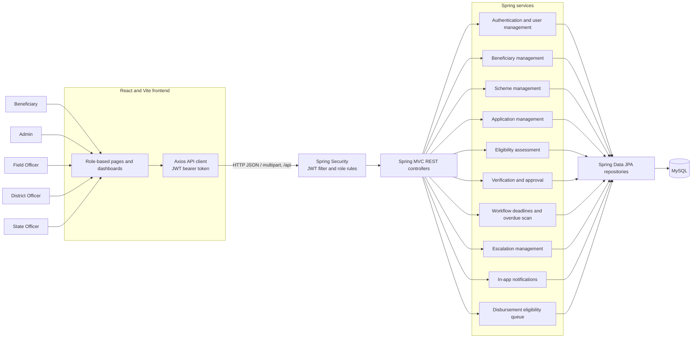
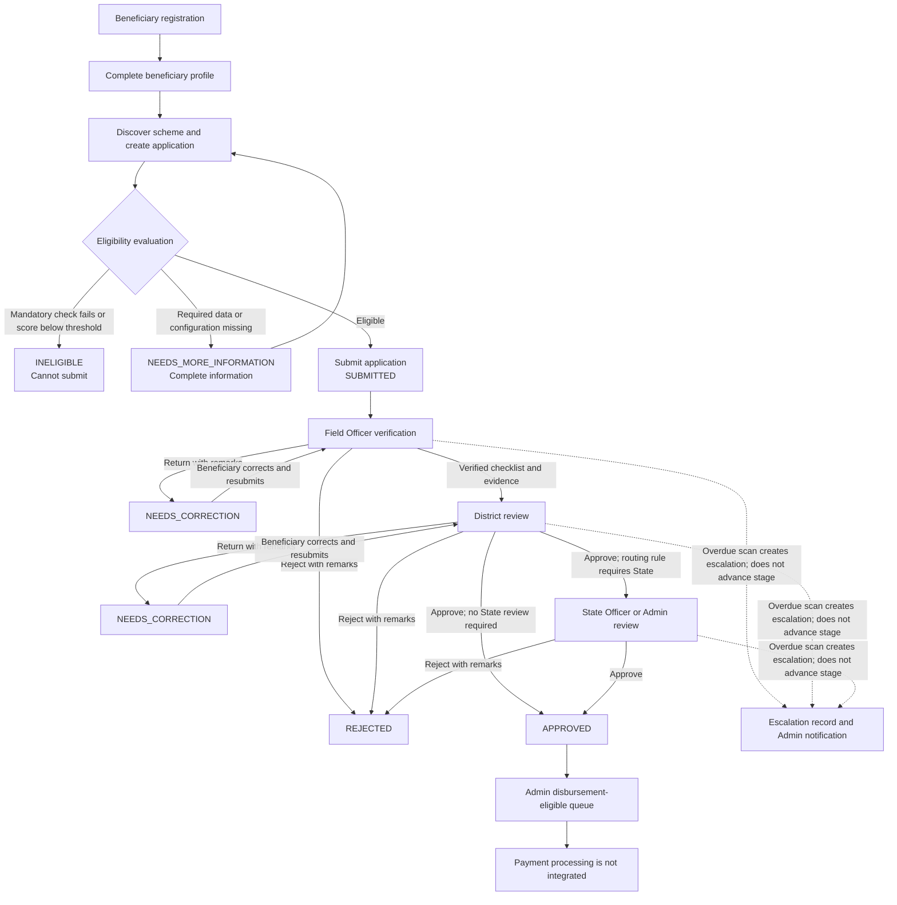

# Grantora

Grantora is a web application for managing government grant schemes and beneficiary applications. It provides scheme configuration, eligibility assessment, application status tracking, and a staged officer review process. Administrators manage schemes, accounts, routing rules, and the queue of approved applications awaiting disbursement processing.

> Grantora currently identifies applications eligible for the disbursement workflow. It does not integrate with a bank or execute payments.

## Table of Contents

- [Project Objectives](#project-objectives)
- [Key Features](#key-features)
- [System Architecture](#system-architecture)
- [Application Workflow](#application-workflow)
- [Technology Stack](#technology-stack)
- [Project Structure](#project-structure)
- [User Roles and Responsibilities](#user-roles-and-responsibilities)
- [Eligibility Assessment Engine](#eligibility-assessment-engine)
- [Multi-Level Verification and Approval](#multi-level-verification-and-approval)
- [Workflow Automation and Escalation](#workflow-automation-and-escalation)
- [Grant Disbursement](#grant-disbursement)
- [Database Design](#database-design)
- [API Documentation](#api-documentation)
- [Installation and Setup](#installation-and-setup)
- [Running the Application](#running-the-application)
- [Testing](#testing)
- [Development Status](#development-status)
- [Future Enhancements](#future-enhancements)
- [License](#license)

## Project Objectives

- Provide one place to configure grant schemes and manage applications.
- Assess applications against scheme-specific mandatory criteria and custom questions.
- Route submitted applications through jurisdiction-aware officer reviews.
- Give beneficiaries and staff a record of application status and verification decisions.

## Key Features

- User registration and login with JWT-based authentication.
- Admin-managed user accounts, grant schemes, eligibility rules, and verification routing rules.
- Beneficiary profiles, scheme discovery, and grant application creation and submission.
- Mandatory eligibility checks plus configurable, points-based scheme questions.
- Field, District, and conditional State review stages with decision history.
- Officer assignment based on stage, active status, and beneficiary jurisdiction.
- Document upload and access checks for supporting evidence.
- Admin queue for approved applications eligible for disbursement processing.
- Partial workflow deadline, overdue escalation, and in-app notification support.

## System Architecture



The frontend is a Vite React single-page application. It sends authenticated requests to the Spring Boot API at `/api`. Spring Security validates JWTs and applies role rules before controller and service logic accesses persisted data through Spring Data JPA. The application is configured for MySQL.

## Application Workflow



The normal progression is Field, then District, then State only when the configured routing rule requires it. Eligibility is checked before submission; it is not a grant award. An escalation does not approve, reject, or advance an application.

## Technology Stack

| Area | Technology and configured version |
|---|---|
| Backend language | Java 17 |
| Backend framework | Spring Boot 4.1.2 (Maven parent in `backend/pom.xml`) |
| API and security | Spring MVC, Spring Security, JWT (`jjwt` 0.12.6) |
| Persistence | Spring Data JPA, Hibernate, MySQL Connector/J (version managed by Spring Boot) |
| Database | MySQL; configured connection targets MySQL 8-compatible syntax |
| Frontend | React 18.3.1, JavaScript, React DOM 18.3.1 |
| Frontend tooling | Vite 6 (package range `^6.0.5`), React Router 6.28.1, Axios (`^1.21.0`), lucide-react 0.468.0 |
| Styling | CSS |

Node.js and npm versions are not pinned in `package.json`; use a current Node.js LTS release with npm.

## Project Structure

```text
Grantora/
├── backend/
│   ├── pom.xml
│   └── src/
│       ├── main/java/com/grantora/
│       │   ├── controller/    # REST endpoints
│       │   ├── dto/           # API request and response types
│       │   ├── entity/        # JPA entities and enums
│       │   ├── repository/    # Spring Data repositories
│       │   ├── security/      # Security chain and JWT filter
│       │   └── service/       # Business and workflow logic
│       ├── main/resources/
│       │   └── application.properties
│       └── test/java/com/grantora/
├── frontend/
│   ├── package.json
│   └── src/
│       ├── components/        # Shared navigation and layout
│       ├── pages/             # Public, Admin, Beneficiary, Officer views
│       ├── services/          # API service modules
│       └── styles/            # Page and layout styles
└── README.md
```

## User Roles and Responsibilities

The application roles are `ADMIN`, `BENEFICIARY`, and `OFFICER`. Officer level is stored separately as `FIELD`, `DISTRICT`, or `STATE`.

| Role / level | Responsibilities supported by the application |
|---|---|
| Beneficiary | Manage their profile, browse schemes, create and submit eligible applications, upload documents, and view application progress. |
| Admin | Manage users, beneficiaries, schemes, routing rules, verification assignments, State-stage final decisions, and the disbursement-eligible queue. Admin access is also available to the workflow configuration and escalation APIs. |
| Field Officer | Review assigned applications at the Field stage, complete the required verification checklist, and return or reject with remarks. |
| District Officer | Review applications after Field verification and approve, return for correction, or reject. Approval may route to State review. |
| State Officer | Review applications assigned to the State stage and record the final approval or rejection. |

## Eligibility Assessment Engine

`EligibilityScoringService` evaluates three mandatory conditions: the beneficiary's age against the scheme's minimum and maximum age, annual income against the scheme maximum, and beneficiary category against the scheme's eligible categories. A missing profile value or missing scheme configuration produces an incomplete result; a failed mandatory condition produces `INELIGIBLE`.

Each scheme is configured with exactly five custom eligibility questions. Answer options carry points and a `meetsEligibilityCondition` flag. The implemented score is:

```text
score out of 100 = points earned / maximum available points × 100
```

The division is rounded to two decimal places using half-up rounding. The maximum is built from required questions plus optional questions that the applicant answered. Required unanswered questions, an incomplete five-question configuration, or missing threshold make the result `NEEDS_MORE_INFORMATION`. After required data and mandatory criteria are satisfied, a score greater than or equal to the scheme threshold yields `ELIGIBLE`; a lower score yields `INELIGIBLE`. The option condition flag is included in the evaluation details, but the current scorer adds the selected option's configured points even when that flag is false.

An eligible result only permits submission. It does not guarantee officer approval or payment. Eligibility is evaluated and saved with the application, and submission is rejected unless the evaluation is `ELIGIBLE`.

## Multi-Level Verification and Approval

- **Field:** reviews identity, address, documents, and application details. A `VERIFIED` decision requires all four checklist confirmations and at least one uploaded supporting document.
- **District:** reviews the Field-stage result and may approve, reject, or request correction. The routing rule determines whether District approval advances to State review or becomes final approval.
- **State:** when required, records the final approval or rejection. Admin final decisions are restricted to the State stage.
- **Assignment:** automatic selection filters for active `OFFICER` accounts at the needed level and matching beneficiary state; Field and District assignments also match district. Admin reassignment is checked against the same stage and jurisdiction constraints. If no eligible automatic assignee exists, the application remains without an assignee; it is not routed to an unrelated officer.
- **Routing:** Admin-managed rules match the stored eligibility score and requested amount ranges, and carry priority and whether State approval is required. Rules are checked when the application is submitted. A matching rule is not a substitute for mandatory Field or District review.
- **History:** decisions and assignment actions are written to application verification history; overall status changes also have application status history. Rejection and correction require remarks. A correction is resubmitted to the same workflow stage.

Existing applications predating the staged workflow may not have a stage or assignee. The code does not automatically migrate or advance those records.

## Workflow Automation and Escalation

Workflow automation is **partially implemented**. The code includes a persisted deadline configuration for Field, District, and State tasks; task assignment, due, and completion timestamps on applications; and a scheduled overdue scan (default fixed delay: 60 seconds, configurable through `grantora.workflow.scan-ms`). The Admin deadline endpoint validates stage deadlines from 1 to 365 days and the stored scan interval from 1 to 1440 minutes.

When a task with an assigned officer and an expired due date is scanned, the service creates an escalation record unless an unresolved record already exists for that application and stage. It marks the application escalated and creates deduplicated in-app notifications for Admin users. Escalation records can be listed and resolved through the workflow API. The current resolve operation records a fixed remark (“Reviewed by Admin”); it does not accept a caller-supplied resolution remark.

Current limitations:

- The overdue scheduler does not itself reassign a task or change its workflow stage.
- Applications with no assigned officer are not included in overdue detection, and there is no implemented Admin notification for the no-assignee case.
- In-app notifications are persistent and can be marked read, but automatic notifications are currently created for overdue events only; the full list of assignment, decision, correction, deadline, and disbursement notification events is not wired.
- Officer escalation visibility is limited to records assigned to that officer, not all records in their jurisdiction.
- The frontend has an Admin deadline settings form and a dashboard notification preview. A full escalation-management screen and comprehensive role-specific automation dashboards are not implemented.
- The scan cadence is controlled by the Spring property. The persisted `scanMinutes` setting is validated and stored, but does not dynamically configure the scheduler.

These features support monitoring; they do not automatically approve, reject, or skip a review stage.

## Grant Disbursement

The implemented endpoint `/api/applications/disbursement/eligible` provides Admins with a paginated list of applications whose status is `APPROVED`. This is an eligibility queue for downstream disbursement work. The repository contains no payment execution integration or disbursement record model for bank references, payment statuses, or beneficiary payment tracking. No real bank payment should be inferred from an `APPROVED` status.

## Database Design

JPA entities are mapped to MySQL tables; schema updates are configured with `spring.jpa.hibernate.ddl-auto=update`. Key entities and relationships include:

| Entity / table | Purpose and relationships |
|---|---|
| `User` / `users` | Login identity, role, active flag, and optional officer level and jurisdiction. |
| `Beneficiary` / `beneficiaries` | Profile associated with a user. |
| `Scheme` / `schemes` | Grant scheme rules, amount limits, eligible categories, threshold, and eligibility questions. |
| `SchemeEligibilityQuestion` / `scheme_eligibility_questions` | Scheme-owned custom question and answer option configuration. |
| `GrantApplication` / `grant_applications` | Belongs to a beneficiary and scheme; stores answers, evaluation, status, workflow stage, assignee, and task timestamps. A beneficiary/scheme pair is unique. |
| `ApplicationDocument` / `application_documents` | Uploaded document linked to an application and uploading user. |
| `ApplicationVerification` / `application_verification_history` | Stage action, actor, assignee, remarks, checklist, and status/stage transitions. |
| `GrantApplicationStatusHistory` / `grant_application_status_history` | Application status changes and their actor/reason. |
| `VerificationRoutingRule` / `verification_routing_rules` | Score and amount bands, priority, and State-review setting. |
| `WorkflowDeadlineConfig` / `workflow_deadline_config` | Persisted stage deadlines and scan interval setting. |
| `WorkflowEscalation` / `workflow_escalations` | Application stage, assignee, reason, creation, and resolution data. |
| `InAppNotification` / `in_app_notifications` | Per-user messages with read timestamp and unique event key per user. |

Eligibility answers and evaluation details are persisted as serialized text fields on applications. No hand-authored database migration files are present. Back up the database and review Hibernate schema changes before deploying to an existing database.

## API Documentation

All backend routes use the `/api` base path. JWT authentication is required except for registration, login, and the health endpoint. The security configuration and controller methods enforce roles and ownership checks; this list is a route overview, not a replacement for those checks.

### Authentication

| Method | Endpoint | Purpose |
|---|---|---|
| `POST` | `/api/auth/register` | Register a user. |
| `POST` | `/api/auth/login` | Authenticate and obtain a JWT response. |

### Beneficiaries and schemes

| Method | Endpoint | Purpose |
|---|---|---|
| `GET` | `/api/beneficiaries` | Admin: list beneficiaries. |
| `GET` | `/api/beneficiaries/me` | View current beneficiary profile. |
| `POST` | `/api/beneficiaries` | Create current beneficiary profile. |
| `PUT` | `/api/beneficiaries/me` | Update current beneficiary profile. |
| `GET` | `/api/beneficiaries/{id}` | Admin: view a beneficiary. |
| `DELETE` | `/api/beneficiaries/{id}` | Admin: delete a beneficiary. |
| `GET` | `/api/schemes`, `/api/schemes/{id}` | List or view schemes (authenticated). |
| `POST` | `/api/schemes` | Create a scheme (Admin). |
| `PUT` | `/api/schemes/{id}` | Update a scheme (Admin). |
| `DELETE` | `/api/schemes/{id}` | Delete a scheme (Admin). |

### Applications and verification

| Method | Endpoint | Purpose |
|---|---|---|
| `GET` | `/api/applications` | Admin/officer application list. |
| `GET` | `/api/applications/admin` | Admin paginated application list, optionally filtered by status. |
| `GET` | `/api/applications/me` | Beneficiary's applications. |
| `POST` | `/api/applications` | Create an application draft. |
| `GET` | `/api/applications/{id}` | View an application when authorized. |
| `PUT` | `/api/applications/{id}` | Update an owned draft or correction response. |
| `POST` | `/api/applications/{id}/submit` | Submit an eligible draft or corrected application. |
| `POST` | `/api/applications/{id}/withdraw` | Withdraw an application when allowed. |
| `DELETE` | `/api/applications/{id}` | Delete a draft. |
| `PATCH` | `/api/applications/{id}/status` | Admin status endpoint; workflow rules restrict invalid changes. |
| `GET` | `/api/applications/verification/assigned` | Assigned verification queue. |
| `GET` | `/api/applications/verification/history` | Verification history visible to the caller. |
| `POST` | `/api/applications/{id}/decision` | Record an authorized verification decision. |
| `POST` | `/api/applications/{id}/assignment` | Admin: assign/reassign to an eligible officer. |
| `POST` | `/api/applications/{id}/escalate` | Escalate/reassign within the current stage when permitted. |
| `POST` | `/api/applications/{id}/documents` | Upload an application document (multipart). |
| `GET` | `/api/applications/{id}/documents/{documentId}` | Download a document when authorized. |
| `GET` | `/api/applications/disbursement/eligible` | Admin: paginated approved application queue. |

### Users, routing, and workflow automation

| Method | Endpoint | Purpose |
|---|---|---|
| `GET`, `POST` | `/api/users` | Admin: list/create users. |
| `GET`, `PUT`, `DELETE` | `/api/users/{id}` | Admin: read/update/delete a user. |
| `GET`, `POST` | `/api/verification/routing-rules` | Admin: list/create routing rules. |
| `PUT`, `DELETE` | `/api/verification/routing-rules/{id}` | Admin: update/delete a routing rule. |
| `GET` | `/api/workflow/deadlines` | Read deadline configuration (Admin/officer). |
| `PUT` | `/api/workflow/deadlines` | Admin: update deadline configuration. |
| `GET` | `/api/workflow/escalations` | Admin or officer: list permitted escalation records. |
| `POST` | `/api/workflow/escalations/{id}/resolve` | Admin: resolve an open escalation. |
| `GET` | `/api/workflow/notifications` | Retrieve caller's notifications and unread count. |
| `POST` | `/api/workflow/notifications/{id}/read` | Mark caller-owned notification as read. |
| `GET` | `/` | Health response. |

## Installation and Setup

### Prerequisites

- Git
- Java 17
- MySQL 8.0
- Node.js LTS and npm

### Clone the repository

```bash
git clone https://github.com/ApoorvaPoojary8/Grantora.git
cd Grantora
```

### Prepare MySQL

Create the local database before starting the backend:

```sql
CREATE DATABASE grantora_db;
```

The checked-in Spring configuration points to `127.0.0.1:3306/grantora_db`. It contains local datasource and JWT settings; never publish real credentials or signing secrets. For local development, override the configured values using environment variables supported by Spring Boot, or edit an uncommitted local configuration. Example for PowerShell:

```powershell
$env:SPRING_DATASOURCE_URL = "jdbc:mysql://127.0.0.1:3306/grantora_db"
$env:SPRING_DATASOURCE_USERNAME = "your_mysql_user"
$env:SPRING_DATASOURCE_PASSWORD = "your_local_password"
$env:JWT_SECRET = "replace_with_a_secure_base64_encoded_secret"
```

Use a Base64-encoded signing key with at least 256 bits of key material, as required by the configured JJWT HMAC key handling. Do not commit secrets. Hibernate `update` may modify the schema at application startup, so review and back up an existing database first.

## Running the Application

Run the backend from the repository root:

```bash
cd backend
./mvnw spring-boot:run
```

On Windows Command Prompt or PowerShell, use:

```powershell
cd backend
.\mvnw.cmd spring-boot:run
```

The API listens on `http://localhost:8080` by default. In a second terminal, run the frontend:

```bash
cd frontend
npm install
npm run dev
```

Vite serves the frontend at `http://localhost:5173`. The frontend API client is configured to call `http://localhost:8080/api`; the backend CORS configuration allows the Vite development origin.

## Testing

Run the existing backend automated tests from `backend/`:

```bash
./mvnw test
```

On Windows, use `.\mvnw.cmd test`. Existing tests cover eligibility scoring, beneficiary service behavior, application submission eligibility, verification workflow behavior, and application controller behavior under `backend/src/test/java`.

The frontend `package.json` defines `npm run build` as its production build check. There is no frontend test script configured. The README update does not claim new or independently rerun test results.

## Development Status

| Area | Status in source |
|---|---|
| Registration/login and role-aware access | Implemented with JWT authentication and route rules. |
| Scheme and beneficiary management | Implemented through REST services and frontend pages. |
| Eligibility assessment | Implemented with mandatory checks, scheme questions, threshold scoring, and incomplete outcomes. |
| Multi-stage verification | Implemented with Field and District required, State conditional on routing rules, and persisted histories. |
| Documents | Upload/download routes and application-level authorization are implemented. |
| Workflow deadlines and overdue escalation | Partially implemented; see [Workflow Automation and Escalation](#workflow-automation-and-escalation). |
| Notifications | Persisted per-user notification APIs are implemented; automatic event coverage is partial. |
| Disbursement | Approved application queue exists; payment processing does not. |

## Future Enhancements

- Complete notification generation for assignments, decisions, correction requests, and deadlines.
- Add a full escalation-management view and jurisdiction-wide officer visibility rules.
- Notify administrators when tasks have no eligible assignee and provide a dedicated recovery queue.
- Apply the persisted scan interval setting to scheduler cadence.
- Add disbursement records and integrate a payment provider only after defining the required controls and audit model.
- Add API-level and frontend automated tests for workflow and access behavior.

## License

The existing project description identifies Grantora as an educational and academic project. No separate `LICENSE` file or standard reuse license is present in the repository; usage and redistribution terms should be clarified by the project owner.
